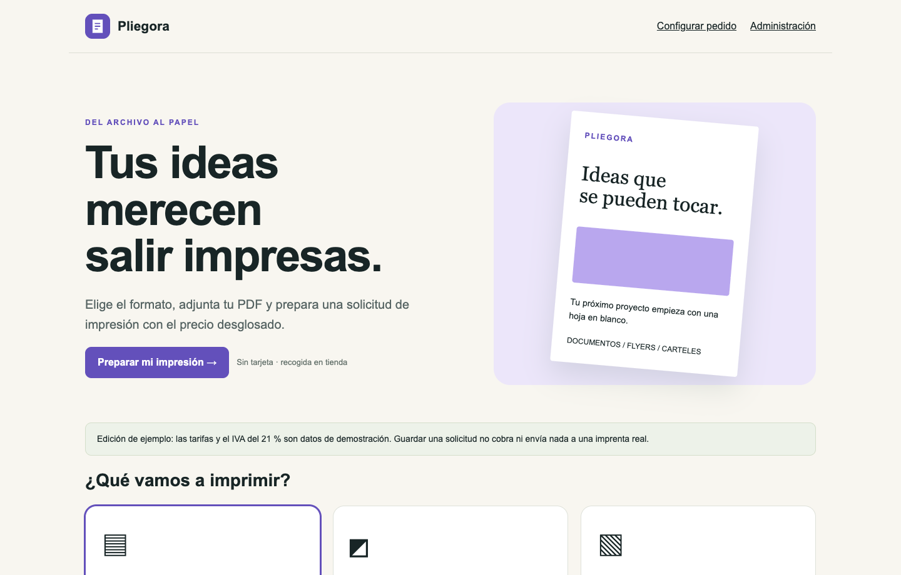

<p align="center"><strong>Pliegora</strong><br>Del archivo al papel.</p>

# Pliegora

Una base abierta para una tienda de impresión: PDF, presupuesto calculado en el servidor, solicitudes privadas y administración de pedidos.

[](LICENSE) [](https://github.com/davidcantonnadales/pliegora/actions/workflows/checks.yml)



## Qué puedes hacer

- Documentos, flyers y carteles con cantidades y opciones.
- Lectura real del PDF: páginas, límite de 20 MB y rechazo de archivos dañados o cifrados.
- Tarifas en céntimos, tramos, acabados e IVA de ejemplo. El servidor recalcula el importe.
- Pedidos persistentes en SQLite; PDFs fuera del directorio público.
- Seguimiento con enlace privado y panel protegido por sesión.
- Estados: pendiente, en impresión, listo, recogido o cancelado.
- Sin cobros, emails, cuentas de clientes ni servicios externos.

## Arrancar en tu equipo

Recomendado: **Node.js 22.13 o posterior de la rama 22**, con npm. `.nvmrc` selecciona Node 22. Las pruebas iniciales locales se ejecutaron con Node 23.10.0; CI utiliza Node 22. Las aplicaciones con SQLite usan `node:sqlite`, que puede mostrar un aviso experimental según la versión.

```bash
npm ci
cp .env.example .env.local
```

Edita `.env.local` y elige `ADMIN_PASSWORD` con al menos 16 caracteres. Sin contraseña configurada, la tienda permite solicitudes pero el panel queda cerrado.

```bash
npm test
npm run dev
```

Abre **http://127.0.0.1:3000**. Producción local: `npm run build` y `npm start`.

## Una prueba de cinco minutos

Sube `examples/documento-demo.pdf` (dos páginas), elige dos ejemplares A4 en blanco y negro, sin encuadernar. El total del ejemplo es 0,48 €. Guarda la solicitud, conserva su enlace y entra al panel para pasarla a En impresión y Listo para recoger.

## Qué incluye esta edición

Es una edición de partida para recogida en tienda. Las tarifas y el 21 % de IVA son ejemplos, no asesoramiento fiscal ni precios de una imprenta real. No incorpora pagos, envíos, preflight de imprenta, control de DPI, antivirus, doble cara ni eliminación automática de pedidos. Antes de uso comercial adapta estas piezas, los textos de privacidad y la retención de archivos.

Esta es una edición pública independiente y adaptada para aprender y desarrollar sobre ella. No incluye datos, credenciales, dominios privados ni infraestructura de la instalación de origen. No pretende reproducir todos los módulos de esa instalación.

## Documentación y pruebas

- [Cómo está organizado y cómo configurarlo](docs/CONFIGURACION.md).
- [Pruebas realizadas y límites](docs/PRUEBAS.md).
- [Procedencia de imágenes y capturas](docs/IMAGENES.md).
- [Seguridad y datos](SECURITY.md).


## Contribuir

Abre una issue con los pasos para reproducir el problema, el resultado esperado y la versión de Node/navegador. Para proponer un cambio, crea una rama, comprueba `npm test` y `npm run build`, y abre una pull request. No adjuntes datos personales, documentos de clientes, claves o archivos `.env`.

## Licencia

Código y documentación bajo [MIT](LICENSE). Las ilustraciones de ejemplo, cuando las hay, se generaron con IA para este proyecto y se distribuyen bajo los mismos términos en la medida en que existan derechos aplicables; no se garantiza exclusividad. Las dependencias conservan sus licencias. No se incluyen marcas ni recursos de terceros para sugerir patrocinio.

Creado por [David Cantón](https://davidcanton.net).
